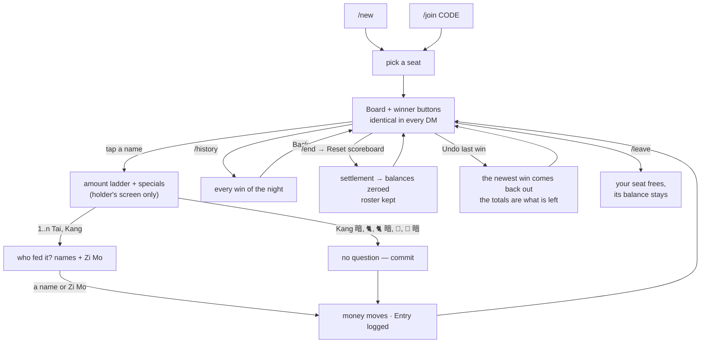
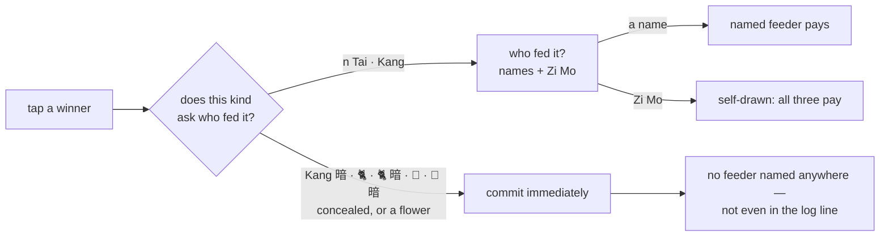
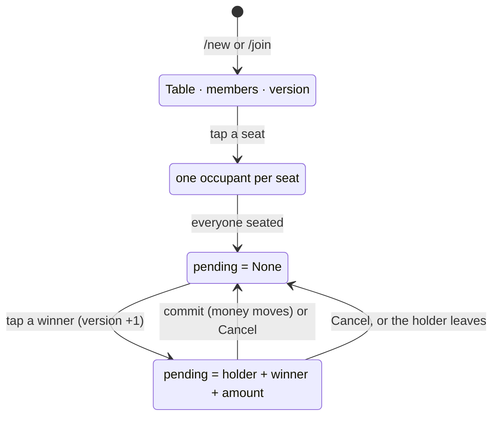
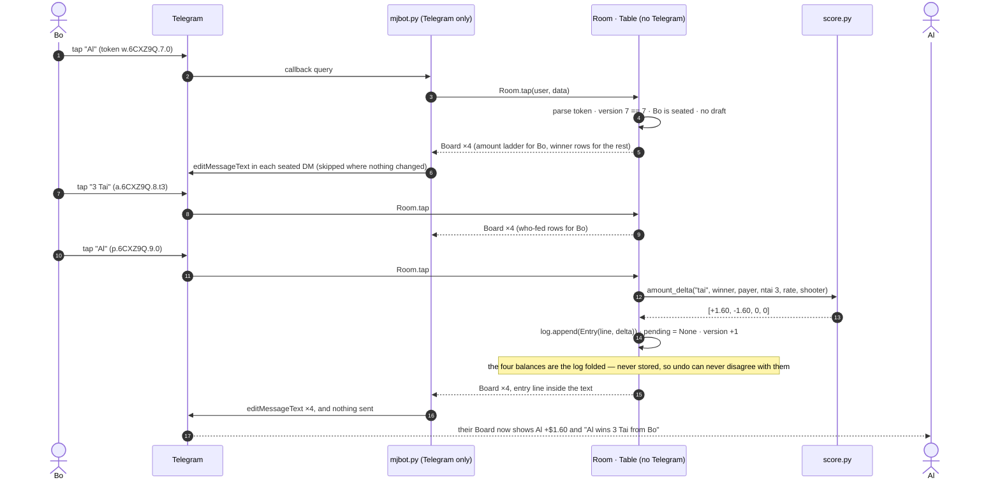
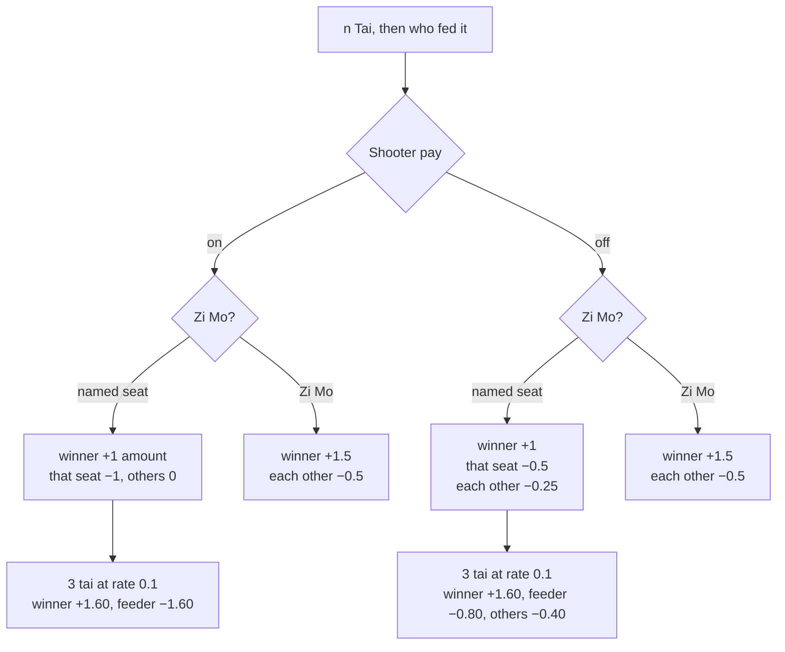
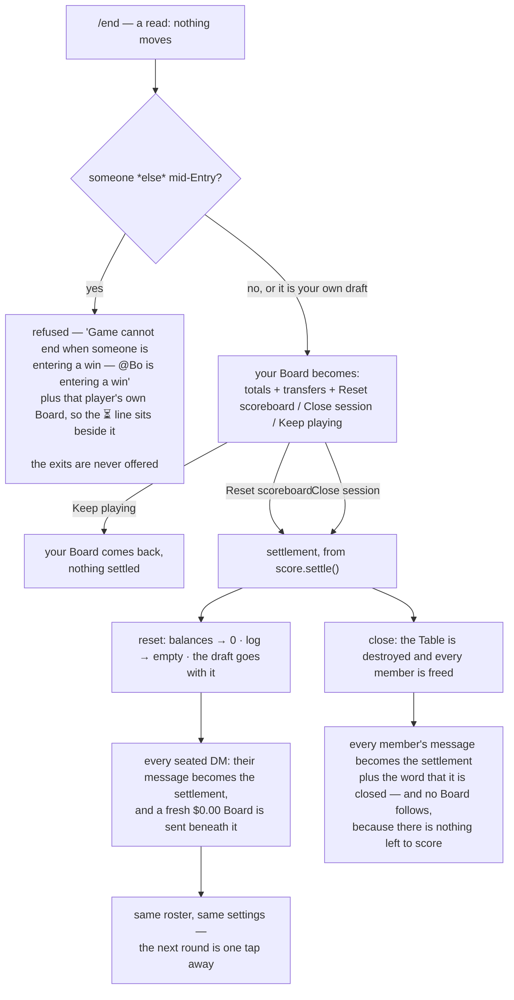
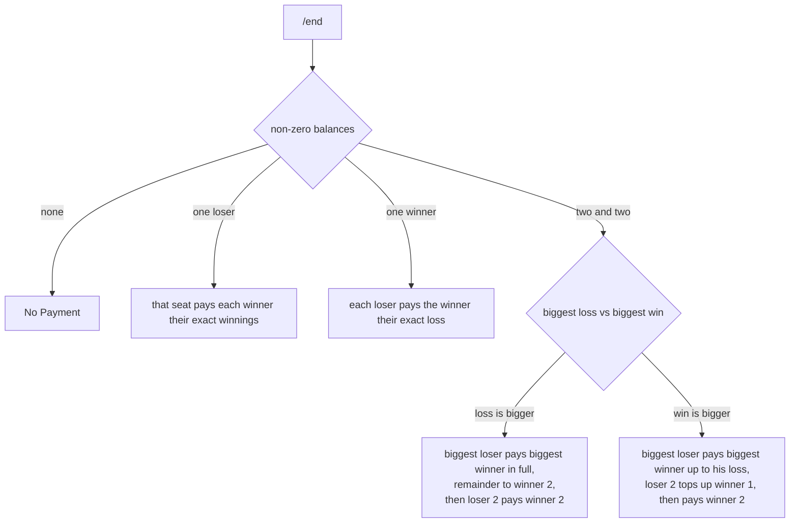

# Play flow — one night in a session

How the bot behaves from a player's side: create a session, sit down, score wins, undo one, settle up. Written
for the Table model (mission `01-pooled-table`, then `02-uiux-overhaul`: named seats, undo, settings open
to the Table, six-character codes); the payout numbers in § 7 are the ones the bot has always produced,
quirks included.

Money shown assumes the default `rate = 0.1`; multiply by `rate / 0.1` for any other rate.

---

## 1. What a night is

One **session** per night, up to four players, and each player talks to the bot only in their own DM. There
is no group chat and no shared screen: every seated player holds **one** message — the **Board** — and the
bot edits that message in place instead of posting new ones.

```
Al ────────┐                                            ┌─ own Board ─┐
Bo ────────┼── one Table in memory ── fan-out ──────────┼─ own Board ─┤
Cy ────────┤    seats · balances · settings · draft     ├─ own Board ─┤
De ────────┘                                            └─ own Board ─┘
```

- **The Board** carries the four seats — `Player 1` to `Player 4`, filled or empty — who sits where,
  each seat's balance, what the session pays
  (`Rate $0.10 · Shooter on · Max tai 5`), and the last three wins. It is the only message the bot keeps
  editing, so a tap never pushes it up the chat.
- **The same text in every DM**, except the two screens that belong to one player alone: the history view
  and the settle-up screen that `/end` opens.
- **The keyboard differs per viewer.** The score is shared; the buttons of a win in progress go only to
  whoever started it.
- **Money lives in the seat, not the person** (AD4). Stand up and the balance stays where you left
  it, so nobody inherits someone else's night.
- Every button's callback data is `kind.code.version.meaning`. The **version** is the Table's single
  staleness fact: a keyboard you left open from an earlier screen says *that message is outdated* rather than
  scoring a second win.
- **The code is the Board's first line**, and it stays there all night: `Session Q7K2HB · 3 of 4 seated`.
  Six characters from an alphabet with no `O`, `I`, `l` or `0` in it, dealt once and never re-dealt while the
  process lives — so a code from last month joins nothing, and a code that gets re-used cannot open a second
  night by accident. It sits on the Board because a seated player is the only way a newcomer gets in, and
  they need something to read out.

---

## 2. Keyboard states you actually see

The Board message always carries exactly one of these.

| Table state | Buttons |
| --- | --- |
| No session bound | `/new`, `/join` |
| Bound, unseated | the free seats only, by number — and the Board's last line reads `Choose which player you are:` rather than the standing ask, because those are the buttons under it (02b/E1). With no seat free it reads `Full — /leave to join another session.` and the message carries no keyboard at all (02b/E2) |
| Seated, nothing pending | one button per seat: the name in it, or **`Player N`** when nobody is in it; **`Undo last win`** on its own row beneath, only while the ledger holds something |
| Amount stage — **holder only** | `1 Tai` … `<max tai> Tai`, then `Kang` / `Kang 暗` / `🐈` / `🐈 暗` / `🥀` / `🥀 暗` two to a row, then `Cancel` |
| Who-fed stage — **holder only** | every other seat — a name, or `Player N` for an empty one — then `Zi Mo`, `Cancel` |
| Someone else's draft | winner buttons as usual, plus the `⏳ Bo is entering a win` line in the Board text |
| History (`/history`) | `Back` — and the text is the whole night instead of the last three wins |
| Settle-up screen (`/end`) | `Reset scoreboard`, `Close session`, `Keep playing` — on the screen of whoever asked |
| Settings (`/settings`, **any seated player**) | `Pay Rate`, `Shooter`, `Max Tai`, `Back`; pickers for shooter and max tai; the rate is **typed** |

---

## 3. Screen flow of a night



The loop `Board → amount → who-fed → Board` is the whole game, and **`Undo last win`** walks one step back
along it whenever the ledger has something to give back. `/end` is only a look at the night's money: what
it offers are two exits, one that leaves the same four players in the same seats with a fresh Board beneath
the settlement, and one that dissolves the session and frees every binding.

---

## 4. Which stage comes next — the only rule worth knowing

One function decides it: `score.has_payer_stage(kind)`. Only `tai` and `Kang` ask — a win a discard
caused has somebody behind it. A flower does not: it belongs to whoever holds it, so nobody fed it
(FR2), and the question it used to ask was one the money never read.



| Tapped | Asked | Why |
| --- | --- | --- |
| `3 Tai` | who fed it | a discard caused it |
| `Kang` | who fed it | likewise |
| `Kang 暗` | nothing | concealed — nobody fed it |
| `🐈`, `🐈 暗` | nothing | an animal win never asks, concealed or not |
| `🥀`, `🥀 暗` | nothing | a flower belongs to whoever holds it (FR1) |

`Zi Mo` = 自摸, self-drawn: nobody fed the winning tile, so all three other seats pay.
`暗` = concealed: you produced it without a discard, so the payout is doubled.

A committed Entry reads on the Board either way — `Al wins 3 Tai from Bo: +$1.60`, `Al wins 3 Tai on Zi
Mo: +$1.60`, or with nobody named at all for a concealed win — **including when the payout is $0.00**,
because the log records what was tapped, not what it was worth.

---

## 5. There is no chat state machine

The 2022 bot remembered "where you are" as one string per chat, and every stuck conversation in its issue
list came from that string. This bot keeps a handful of pieces of state, all of them small and all of them owned by the Table rather
than the chat:



| State | Where it lives | What clears it |
| --- | --- | --- |
| Who is entering a win | `table.pending` — one dict, one at a time, Table-wide | commit, `Cancel`, or the holder leaving |
| A question waiting for a typed answer | `Room.asked` — who was asked, and *what* (a session code, or a pay rate) | **anything** they send next. A command is never an answer, and a sticker is not an attempt at one |
| Whether a keyboard is still current | the `version` inside the token | every committed change bumps it; nothing else stores it |
| The night's wins, and so every balance | `table.log` — one `Entry(text, delta)` per win, in the order they landed | `Reset scoreboard` empties it and `Close session` destroys it; **`Undo last win`** pops its newest one. The four balances are never stored: they are this list folded up (02/AD2) |

A tap whose version has been superseded is refused with `That message is outdated, tap on the new message
or wait for it to be refreshed.` and nothing moves — and the refusal re-draws the tapper's own screen, which
is the only thing that makes "wait for it to be refreshed" true (02b/D11). Seat picks and `Back` are exempt,
because their meaning is decided by the Table's current state and not by the screen that produced them.

---

## 6. One tap, end to end



One scored win costs **edits only** — no new message in any DM. Everything is in process memory: a restart
dissolves every Table, and there is nothing to recover.

---

## 7. Money per tap

### Tai win — `score._tai`

`tai amount = rate × TAI_LADDER[n]`, the ladder doubling per rung: `1→4, 2→8, 3→16, 4→32, 5→64 … 10→2048`.
At rate 0.1 that is `$0.40` at tai 1, `$1.60` at tai 3, `$6.40` at tai 5. The rung a session may *offer* is
capped twice over: by the session's Max Tai (any seated player may set it), and by the ladder itself
(`score.MAX_TAI` = 10) — a rung above it has no payout to give.



### Kang, animal and flower — flat rate, no ladder

These factors multiply `rate` alone; the tai ladder never applies, so a 3-tai win and a 3-tai-worth of
flowers are different amounts. A seat is a slot, never a person: an empty one pays and is paid, and is
named by its number (AD4, FR5).

| Entry | Shooter ON | Shooter OFF |
| --- | --- | --- |
| `Kang` + named feeder | winner +0.30, feeder −0.30 | winner +0.30, all three others −0.10 each |
| `Kang` + `Zi Mo` | winner +0.30, each −0.10 | winner +0.60, each −0.20 |
| `Kang 暗` | winner +0.60, each −0.20 | winner +1.20, each −0.40 |
| `🐈` | winner +0.30, each −0.10 | identical |
| `🐈 暗` | winner +0.60, each −0.20 | identical |
| `🥀` | winner +0.30, each −0.10 | identical |
| `🥀 暗` | winner +0.60, each −0.20 | identical |

> ⚠️ **One live quirk, kept on purpose** (FR23 — the numbers are a frozen contract, `tests/golden_payouts.json`):
> with Shooter **off**, a `Kang` ignores the feeder you picked and all three pay evenly. Fixing it would
> change what players have been settling on for years, so it is documented here instead.
>
> The second quirk that used to sit here is gone, and it is the one change this mission makes to money:
> a `🥀` with a *named* feeder used to move no money at all when Shooter was off. `🥀` no longer asks who
> fed it, so there is no tap left to make that happen (FR1).

---

## 8. Settling up and closing — `/end`

`/end` itself moves nothing. It edits the one message in the asker's chat into the night's money — every
total, every transfer — and puts the two irreversible exits underneath it. There is no second "are you
sure": the screen showing what the tap costs *is* the confirmation, and it is on screen while the thumb is
moving. `Undo last win` reaches neither exit.



Both exits print the settlement before they destroy anything, and both leave it standing in the chat: the
money is settled by hand, off the bot, and the screen is where it is read from. Closing deletes the last
copy of the numbers from the bot's side, so a bare *closed* notice written over them would destroy the
debt to announce it.

A half-entered win stops a **bystander** and stops **nobody** at their own (02b/D8, 02b/D17): the draft is
another player's work, and no confirmation buys the right to discard it — but the holder's own thumb
reaching `Reset scoreboard` says exactly what they want, and the draft is cleared with the ledger so the
next tap is never judged against a win that no longer exists.

The bystander's refusal is said **at the ask** (02b/E3, Jon 2026-10-30): `/end` over someone else's draft
sends the sentence and never shows the exits, rather than offering two destructive buttons and taking them
back one tap later. Two things follow, and both are Telegram's, not the bot's:

- **The refusal cannot be a popup at `/end`.** A popup is printed on the receipt a button press hands the
  bot (`answerCallbackQuery`), and a typed verb hands over no receipt — so a typed command can only send a
  message, redraw a screen, or say nothing. Where the same situation *is* a tap, it does get a popup.
- **A settle-up screen cannot outlive the draft.** Starting an Entry bumps `version`, so the `k…reset` and
  `k…close` tokens on a screen drawn before it die at the version check and answer with the shared
  `That message is outdated…` popup. `_settle_up` and `_close_session` still re-check the draft as the
  backstop behind that, and it shares the same popup rather than a sentence of its own (02b/D9).

The transfer lines come from `score.settle`, the old `howtopay` logic, in its own order:



A seat nobody is sitting in still owes and is still owed, because the money is in the slot: the line
reads `Player 3 (empty) pays Al: $3.20` rather than naming a person who is not there. An empty seat may
win and may feed, so a short-handed night keeps scoring (FR3, FR4); what it settles into is settled by
hand — four seated is what a night is meant to look like (AS4).

---

## 9. Commands, and who may use them

| Command | Who | Notes |
| --- | --- | --- |
| `/start` | new chat only | Starts the bot. Once a chat has a session the verb leaves the menu — the menu already carries every verb *and* its description, so a help listing in the chat was a reprint of it |
| `/new` | unbound | You create the session and pick a seat, and the six-character code goes on the first line of your Board — `Session Q7K2HB · 1 of 4 seated` — where it stays all night for whoever you read it to. The code is the whole way in: no seat is senior to another, and there is no role anybody holds (04/D4) |
| `/join CODE` | unbound | Six characters, exactly, the whole message, case-insensitive — never read out of the middle of a sentence. A bare `/join` asks for the code; your next message is the answer, and one attempt only. Any seated player's Board names their session's code on its first line |
| `/history` | seated | Every Entry of the night, in your own message; `Back` returns the score |
| `/settings` | **seated** | Pay rate (typed), shooter, max tai (both picked). Whoever holds the tiles decides what they pay: the seat is the whole rule, so no settings refusal is left to say who to go and ask |
| `/end` | seated | Shows the settle-up screen; both of its exits refuse while anyone holds a draft |
| `/leave` | in a session | Frees your seat and your binding; its balance stays |

`/history`, `/end` and `/settings` never appear in a player's slash menu until they can use them, and none
of them ever appears for a player who cannot use it — the menu is set per player, because a menu offering a
verb that only refuses them teaches players that menus lie. The same reasoning removed `/start` from the
menu of a chat that already has a session (FR26), and it is why `/settings` stopped being offered by role:
every tap already honoured it, so the menu was the one place still lying about it. Since 04/D4 the two
seated menus are identical, because nothing is left to reserve to anyone.

---

## 10. Where each piece lives

| Behaviour | Code |
| --- | --- |
| Telegram: handlers, keyboards, delivery, breaker, polling | `mjbot.py` — the only file that imports `telebot` |
| Table state, seats, settings, drafts, tap rules, tokens | `table.py` — `Room` (verbs and taps) and `Table` (state). Also which buttons a screen carries, and the one-line refusals: a button is a token, and a token is a rule |
| Payout math, settlement lines, the tai ladder | `score.py` — pure functions, no state, no Telegram |
| The sentences a player *waits* to read — the Board, the night's list, the settlement, one win's line | `render.py` — `board`, `history`, `settlement`, `entry_line`, `settings`, `entering` |
| The one-line refusals a tap answers with | `table.py` — the rule's own words, kept beside the rule that decides them. Stay there (02b): `render.py` holds the sentences a player *waits* to read, and a popup is the opposite of waiting |
| One Board message per chat, edits not sends; retries and write holding | `mjbot.py` — `Delivery`, `reconcile` |
| Which verbs a player is offered | `table.py` — `commands_for`, `COMMAND_HELP` |
| The frozen numbers | `tests/golden_payouts.json` — 640 tai cases, 160 Kang and 64 🥀 rows (only the states a player can actually reach: a 🥀 no longer names a feeder, and the rows that pinned an unreachable state were deleted rather than re-pinned), 4 full nights, 10 settlements |
