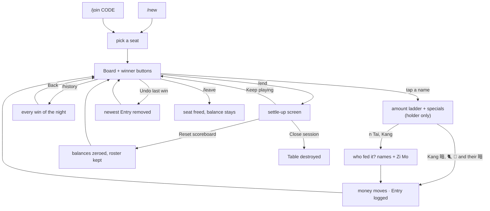

# Play flow

How the bot behaves from a player's side, and which piece of state owns what. Money rules are in
[payouts.md](payouts.md).

---

## Model

One **session** per night, up to four players, each talking to the bot only in their own DM. Every seated player
holds one message, the **Board**, and the bot edits it in place rather than posting new ones. A scored win costs
edits only. All state is in process memory, so a restart dissolves every session.

```
Al ────────┐                                            ┌─ own Board ─┐
Bo ────────┼── one Table in memory ── fan-out ──────────┼─ own Board ─┤
Cy ────────┤    seats · balances · settings · draft     ├─ own Board ─┤
De ────────┘                                            └─ own Board ─┘
```

- **The Board** shows the session code and seat count (`Session Q7K2HB · 3 of 4 seated`), the four seats with
  balances, the session settings, and the last three wins.
- **Seats, not people, hold money.** Standing up leaves the balance in the seat. An empty seat can still win,
  feed and owe.
- **Labels belong to the Table.** Renaming a seat affects only that session. Buttons carry the seat number, never
  the name.
- **The session code** is six characters from an alphabet without `O`, `I`, `l` or `0`. It is dealt once, never
  re-dealt while the process lives, and is the only way in: a seated player reads it out to a newcomer.
- **The text is the same in every DM**, except `/history` and the `/end` settle-up screen, which belong to the
  asker. Keyboards differ: the buttons of a win in progress go only to whoever started it.
- **Staleness.** Every button's callback data is `kind.code.version.meaning`. A tap on a superseded version is
  refused with `That message is outdated…` and the tapper's screen is redrawn. Seat picks and `Back` are exempt.

---

## Screens



- Unseated players see only the free seats (or no keyboard when the Table is full).
- Only `n Tai` and `Kang` ask who fed the win ([payouts.md](payouts.md)).
- `Change player names` (in `/settings`) is offered only while a seat is free, and is refused to a player holding a
  draft.

---

## State

| State | Lives in | Cleared by |
| --- | --- | --- |
| The win being entered | `table.pending`, one per Table | Commit, `Cancel`, or the holder leaving |
| A typed answer being awaited (code, rate, or a seat's new name) | `Room.asked`, one `Ask(kind, seat)` per player | Anything they send next, including any tap. A rejected name re-arms for the same seat. |
| Whether a keyboard is current | `version` in the token | Every committed change bumps it |
| The night's wins and every balance | `table.log`, one `Entry(text, delta)` per win | `Reset scoreboard` empties it, `Close session` destroys it, `Undo last win` pops the newest. Balances are never stored; they are the log folded. |

---

## `/end`

`/end` moves nothing. It turns the asker's Board into the settlement (totals and transfers) with three buttons:
`Reset scoreboard`, `Close session`, `Keep playing`. The screen showing the cost is the confirmation, so there is
no second prompt, and `Undo last win` cannot reach either exit.

- **Reset scoreboard** zeroes balances and the log, keeps the roster and settings, and sends a fresh Board under
  the settlement.
- **Close session** destroys the Table and frees every member. No Board follows.
- Both leave the settlement in the chat, because settling happens by hand off the bot.
- Someone else mid-entry blocks `/end` with a message naming them and shows no exits. The holder's own draft does
  not block, and is cleared with the ledger.

---

## Commands

| Command | Who | Does |
| --- | --- | --- |
| `/start` | new chat | Starts the bot. |
| `/new` | unbound | Creates a session and asks for a seat. |
| `/join CODE` | unbound | Six characters, the whole message, case-insensitive. A bare `/join` asks for the code. |
| `/history` | seated | Every Entry of the night; `Back` returns to the Board. |
| `/settings` | seated | Pay rate (typed), shooter, max tai, player names. Any seated player may change them. |
| `/end` | seated | Settle-up screen. |
| `/leave` | in a session | Frees your seat and binding; the balance stays. |

The slash menu is set per player and lists only the verbs they can currently use.

---

## Where it lives

| Concern | File |
| --- | --- |
| Telegram handlers, delivery, polling | `mjbot.py` (the only file importing `telebot`) |
| Table state, tap rules, tokens, keyboards, one-line refusals, command menu | `table.py` |
| Payout math and settlement | `score.py` |
| Text a player waits to read: Board, history, settlement | `render.py` |
