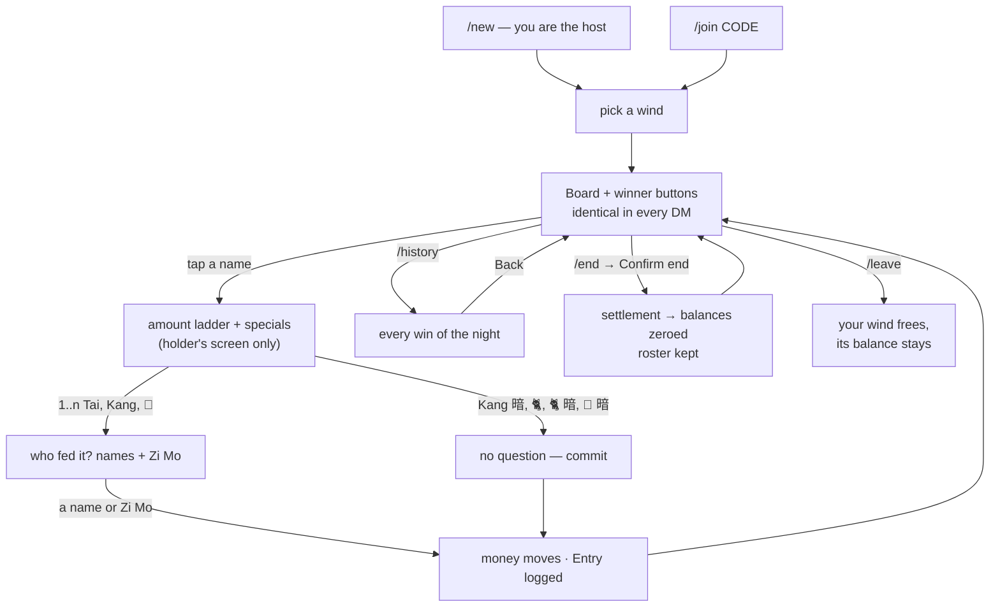
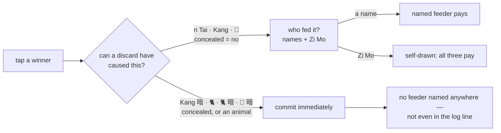
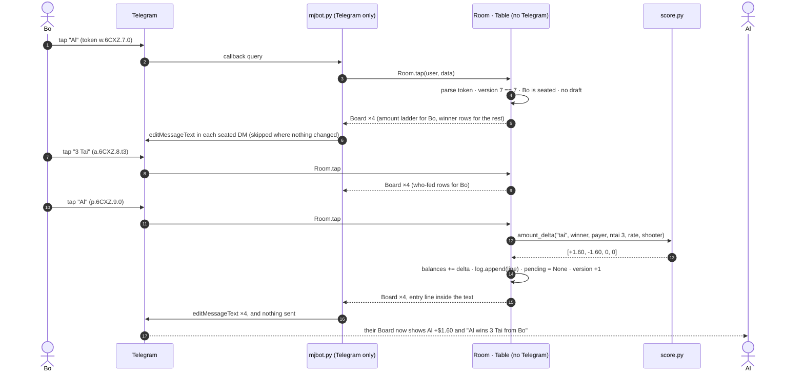
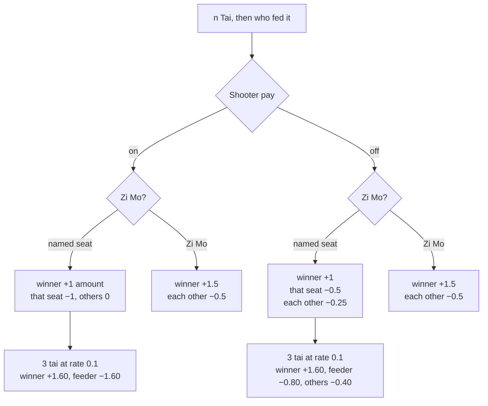
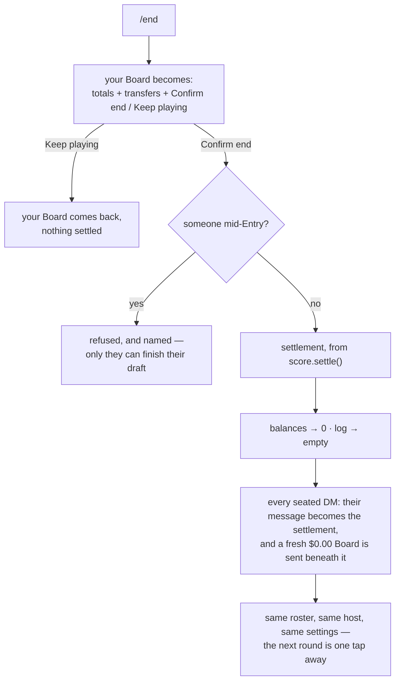
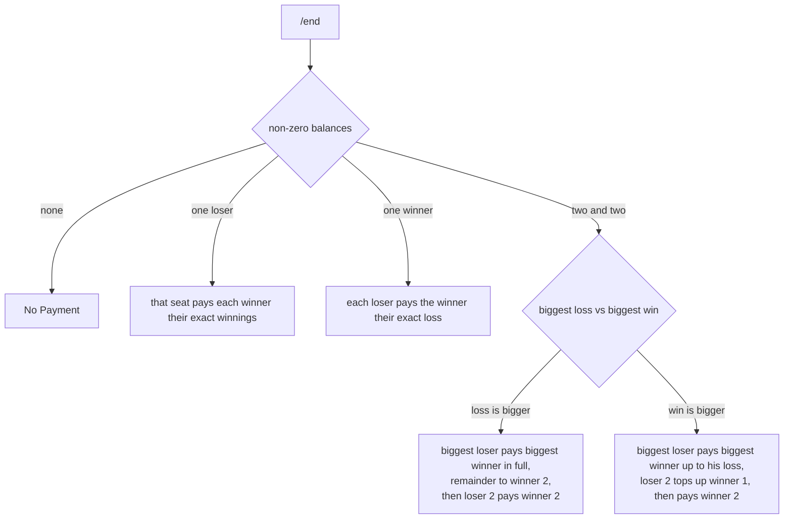

# Play flow — one night at a Table

How the bot behaves from a player's side: open a Table, sit down, score wins, settle up. Written for the
Table model (mission `01-pooled-table`); the payout numbers in § 7 are the ones the bot has always
produced, quirks included.

Money shown assumes the default `rate = 0.1`; multiply by `rate / 0.1` for any other rate.

---

## 1. What a night is

One **Table** per night, up to four players, and each player talks to the bot only in their own DM. There
is no group chat and no shared screen: every seated player holds **one** message — the **Board** — and the
bot edits that message in place instead of posting new ones.

```
Al (host) ─┐                                            ┌─ own Board ─┐
Bo ────────┼── one Table in memory ── fan-out ──────────┼─ own Board ─┤
Cy ────────┤    seats · balances · settings · draft     ├─ own Board ─┤
De ────────┘                                            └─ own Board ─┘
```

- **The Board** carries the four winds, who sits where, each seat's balance, what the Table pays
  (`Rate $0.10 · Shooter on · Max tai 5`), and the last three wins. It is the only message the bot keeps
  editing, so a tap never pushes it up the chat.
- **The same text in every DM**, except the two screens that belong to one player alone: the history view
  and the `/end` confirmation.
- **The keyboard differs per viewer.** The score is shared; the buttons of a win in progress go only to
  whoever started it.
- **Money lives in the wind seat, not the person** (AD4). Stand up and the balance stays where you left
  it, so nobody inherits someone else's night.
- Every button's callback data is `kind.code.version.meaning`. The **version** is the Table's single
  staleness fact: a keyboard you left open on the table says *that screen is out of date* rather than
  scoring a second win.

---

## 2. Keyboard states you actually see

The Board message always carries exactly one of these.

| Table state | Buttons |
| --- | --- |
| No Table bound | `/new`, `/join` |
| Bound, unseated | the free winds only |
| Seated, nothing pending | one button per seated player's **name** (winds never appear on buttons) |
| Amount stage — **holder only** | `1 Tai` … `<max tai> Tai`, then `Kang` / `Kang 暗` / `🐈` / `🐈 暗` / `🥀` / `🥀 暗` two to a row, then `Cancel` |
| Who-fed stage — **holder only** | each other seated player's name, `Zi Mo`, `Cancel` |
| Someone else's draft | winner buttons as usual, plus the `⏳ Bo is entering a win` line in the Board text |
| History (`/history`) | `Back` — and the text is the whole night instead of the last three wins |
| End confirmation (`/end`) | `Confirm end`, `Keep playing` — on the screen of whoever asked |
| Settings (`/settings`, host) | `Pay Rate`, `Shooter`, `Max Tai`, `Back`; pickers for shooter and max tai; the rate is **typed** |

---

## 3. Screen flow of a night



The loop `Board → amount → who-fed → Board` is the whole game. `/end` does not close the Table: the same
four players carry on into the next round with nothing but a fresh Board beneath the settlement.

---

## 4. Which stage comes next — the only rule worth knowing

One function decides it: `score.has_payer_stage(kind)`. A win that a discard could have caused asks who
fed it; a win you produced yourself asks nothing.



| Tapped | Asked | Why |
| --- | --- | --- |
| `3 Tai` | who fed it | a discard caused it |
| `Kang` | who fed it | likewise |
| `🥀` (flower) | who fed it | a flower can be charged to one player alone |
| `Kang 暗` | nothing | concealed — nobody fed it |
| `🐈`, `🐈 暗` | nothing | an animal win never asks, concealed or not |
| `🥀 暗` | nothing | concealed |

`Zi Mo` = 自摸, self-drawn: nobody fed the winning tile, so all three other seats pay.
`暗` = concealed: you produced it without a discard, so the payout is doubled.

A committed Entry reads on the Board either way — `Al wins 3 Tai from Bo: +$1.60`, `Al wins 3 Tai on Zi
Mo: +$1.60`, or with nobody named at all for a concealed win — **including when the payout is $0.00**,
because the log records what was tapped, not what it was worth.

---

## 5. There is no chat state machine

The 2022 bot remembered "where you are" as one string per chat, and every stuck conversation in its issue
list came from that string. This bot keeps exactly three pieces of state, all of them small and all of
them owned by the Table rather than the chat:


| State | Where it lives | What clears it |
| --- | --- | --- |
| Who is entering a win | `table.pending` — one dict, one at a time, Table-wide | commit, `Cancel`, or the holder leaving |
| A question waiting for a typed answer | `Room.asked` — who was asked, and *what* (a table code, or a pay rate) | **anything** they send next. A command is never an answer, and a sticker is not an attempt at one |
| Whether a keyboard is still current | the `version` inside the token | every committed change bumps it; nothing else stores it |

A tap whose version has been superseded is refused with `That screen is out of date — send /board for the
newest one.` and nothing moves. Seat picks and `Back` are exempt, because their meaning is decided by the
Table's current state and not by the screen that produced them.

---

## 6. One tap, end to end



One scored win costs **edits only** — no new message in any DM. Everything is in process memory: a restart
dissolves every Table, and there is nothing to recover.

---

## 7. Money per tap

### Tai win — `score._tai`

`tai amount = rate × TAI_LADDER[n]`, the ladder doubling per rung: `1→4, 2→8, 3→16, 4→32, 5→64 … 10→2048`.
At rate 0.1 that is `$0.40` at tai 1, `$1.60` at tai 3, `$6.40` at tai 5. The rung a Table may *offer* is
capped twice over: by the host's Max Tai, and by the ladder itself (`score.MAX_TAI` = 10) — a rung above
it has no payout to give.



### Kang, animal and flower — flat rate, no ladder

These factors multiply `rate` alone; the tai ladder never applies, so a 3-tai win and a 3-tai-worth of
flowers are different amounts. Seats are named by whoever sits there — winds are labels, never money
(AD4).

| Entry | Shooter ON | Shooter OFF |
| --- | --- | --- |
| `Kang` + named feeder | winner +0.30, feeder −0.30 | winner +0.30, all three others −0.10 each |
| `Kang` + `Zi Mo` | winner +0.30, each −0.10 | winner +0.60, each −0.20 |
| `Kang 暗` | winner +0.60, each −0.20 | winner +1.20, each −0.40 |
| `🐈` | winner +0.30, each −0.10 | identical |
| `🐈 暗` | winner +0.60, each −0.20 | identical |
| `🥀` + named feeder | winner +0.10, feeder −0.10 | **see quirk** |
| `🥀` + `Zi Mo` | winner +0.30, each −0.10 | identical |
| `🥀 暗` | winner +0.60, each −0.20 | identical |

> ⚠️ **Two live quirks, kept on purpose** (FR23 — the numbers are a frozen contract, `tests/golden_payouts.json`):
> with Shooter **off**, a `Kang` ignores the feeder you picked and all three pay evenly; and with Shooter
> **off**, a `🥀` with a *named* feeder moves no money at all and says nothing. Fixing either would change
> what players have been settling on for years, so they are documented here instead.

---

## 8. Settling up — `/end`

`/end` is destructive and irreversible (no undo, memory only), so it **asks first** on the screen of
whoever typed it, showing the very transfers a confirm would post.



The transfer lines come from `score.settle`, the old `howtopay` logic, in its own order:



A wind seat that nobody is sitting in still owes and is still owed, because the money is in the slot: the
line reads `西 (empty) pays Al: $3.20` rather than naming a person who is not there. That is the
short-handed night, and it is settled by hand — four seated is what a night is meant to look like (AS4).

---

## 9. Commands, and who may use them

| Command | Who | Notes |
| --- | --- | --- |
| `/start` | anyone | The verbs *you* can use and what they do, plus your Board. Never resets anything |
| `/new` | unbound | You become the host. There is no host transfer, so the role survives `/leave` |
| `/join CODE` | unbound | A bare `/join` asks for the code; your next message is the answer, and one attempt only |
| `/board` | seated | Refresh, plus one line naming what you can tap |
| `/history` | seated | Every Entry of the night, in your own message; `Back` returns the score |
| `/settings` | host | Pay rate (typed), shooter, max tai (both picked). Refusals name the host |
| `/end` | seated | Asks, then settles; refuses while anyone holds a draft |
| `/leave` | seated | Frees your wind and your binding; its balance stays |
| `/close` | host | Dissolves the Table and frees everyone's binding |

`/history` and `/end` never appear in a player's slash menu until they can use them — the menu is set per
player, because a menu offering a verb that only re-shows the Board teaches players that menus lie.

---

## 10. Where each piece lives

| Behaviour | Code |
| --- | --- |
| Telegram: handlers, keyboards, delivery, breaker, polling | `mjbot.py` — the only file that imports `telebot` |
| Table state, seats, settings, drafts, tap rules, tokens | `table.py` — `Room` (verbs and taps) and `Table` (state) |
| Payout math, settlement lines, the tai ladder | `score.py` — pure functions, no state, no Telegram |
| Every word a player reads | `render.py` — `board`, `history`, `settlement`, `entry_line`, `settings` |
| One Board message per chat, edits not sends; retries and write holding | `mjbot.py` — `Delivery`, `reconcile` |
| Which verbs a player is offered | `table.py` — `commands_for`, `COMMAND_HELP` |
| The frozen numbers | `tests/golden_payouts.json` — 640 tai cases, the bonus kinds, full nights, settlements |
