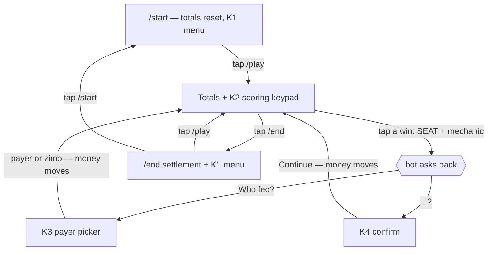
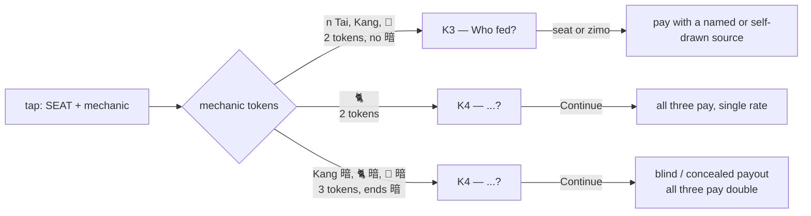
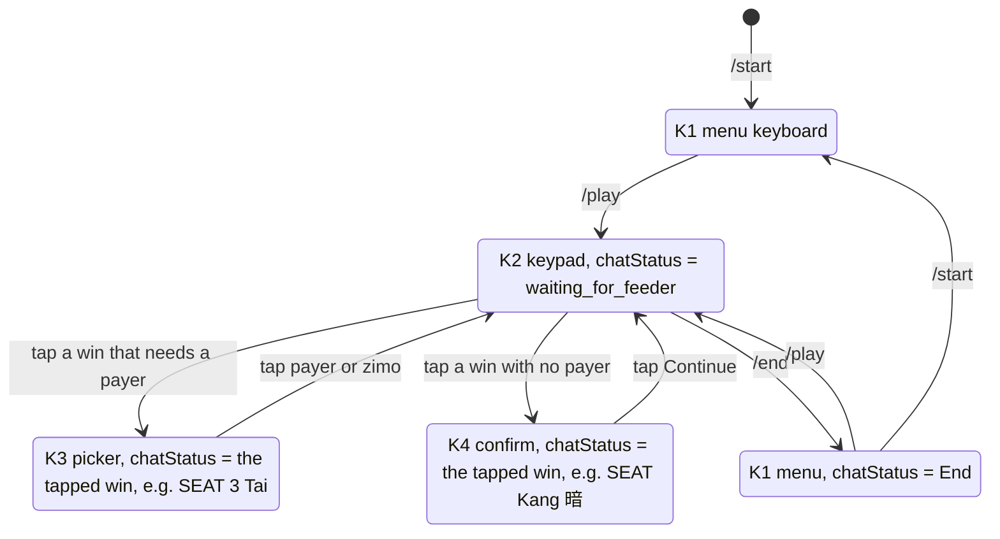
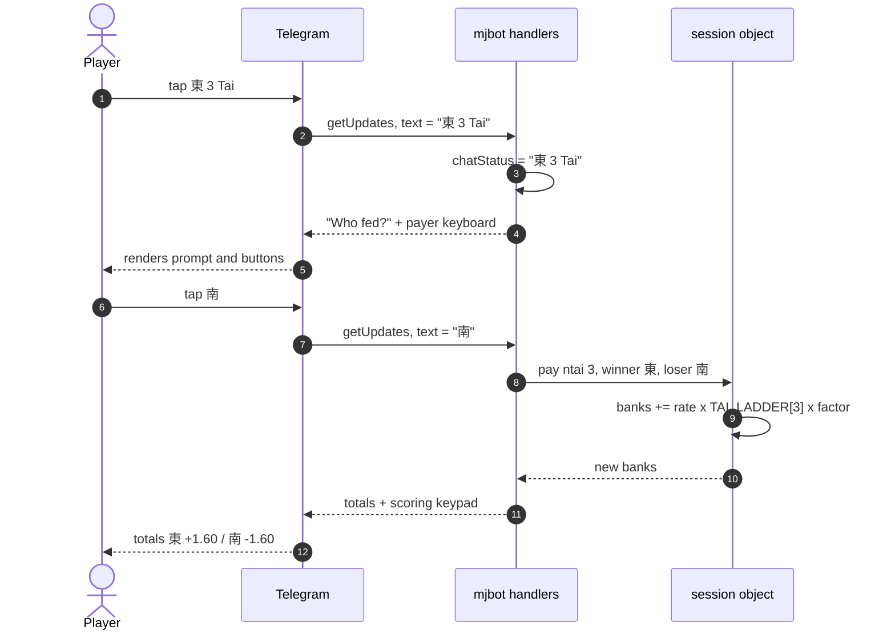
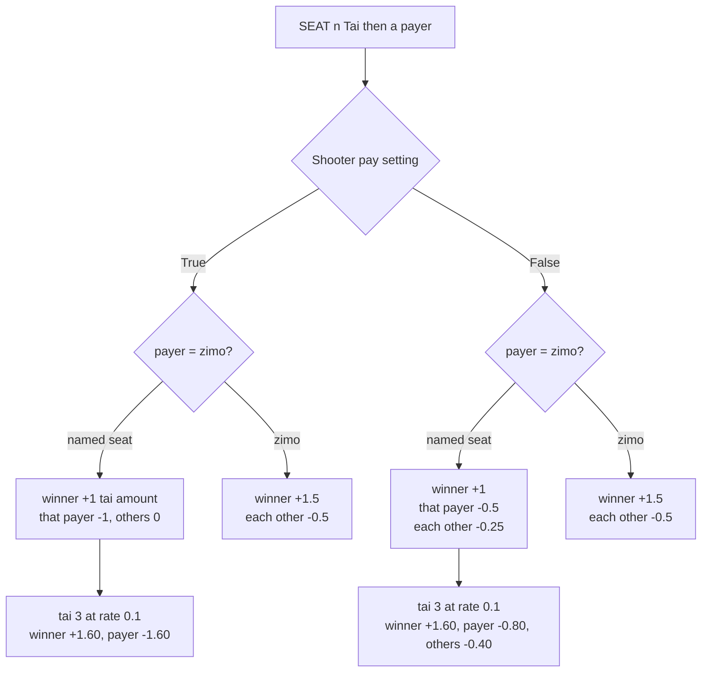
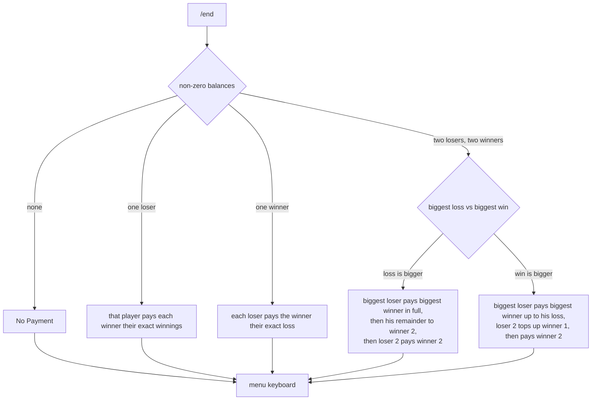

# Play flow — normal flow

> ⚠️ **Stale since slice 1 of `01-pooled-table`.** This page describes the old one-chat-per-game
> bot: `util.py` and the reply keyboards it names are gone (the money moved to `score.py`, the
> flow to `table.py` / `render.py` / `mjbot.py`). Slice 8 rewrites it for Tables. The payout
> numbers in § 6 are still exact.

Flow and UI map of a normal scoring session: `/start` → `/play` → tap wins → `/end`.

Covers tai wins **and** the bonus rows (`Kang`, `Kang 暗`, `🐈`, `🐈 暗`, `🥀`, `🥀 暗`).
Out of scope: `/settings`, `Manual Edits`, `Remove Last`, and every `Invalid Entry` branch.

Money shown assumes the default `rate = 0.1`; multiply by `rate / 0.1` for other rates.

---

## 1. Keyboards you actually see

The bot only ever shows one of four reply keyboards. Each tap is a plain text message
back into the bot, so the keyboard *is* the UI.

| # | Keyboard | Shown when | Buttons |
| --- | --- | --- | --- |
| K1 | Menu | after `/start` and after `/end` | `/start` `/play` `/end` `/settings` |
| K2 | Scoring keypad | after `/play`, and after every scored win | `SEAT 1 Tai` … `SEAT <maxtai> Tai`, `SEAT Kang`, `SEAT Kang 暗`, `SEAT 🐈`, `SEAT 🐈 暗`, `SEAT 🥀`, `SEAT 🥀 暗` — each × 4 seats, then `Manual Edits` `Remove Last` `/end` |
| K3 | Payer picker | you tapped a win that needs a feeder | 3 seats (winner's own seat is omitted), `zimo`, `Back` |
| K4 | Confirm | you tapped a win that has no feeder | `Continue`, `Back` |

All four are `one_time_keyboard`, so a keyboard disappears the moment you tap it —
the bot must resend it, which is why every scored win re-prints the totals with K2.

K2 is one row per mechanic, repeated across the four seats, plus a utility row:

| Keypad rows | Across seats |
| --- | --- |
| `1 Tai` … `<maxtai> Tai` | `東` `南` `西` `北` — so `maxtai` 5 gives 5 rows, `maxtai` 10 gives 10 |
| `Kang` · `Kang 暗` | `東` `南` `西` `北` |
| `🐈` · `🐈 暗` | `東` `南` `西` `北` |
| `🥀` · `🥀 暗` | `東` `南` `西` `北` |
| utility row | `Manual Edits` · `Remove Last` · `/end` |

---

## 2. Screen flow of one round

The loop `K2 → prompt → K2` is the whole game: it repeats until someone taps `/end`.

---

## 3. Which prompt you get — the only rule worth knowing

The bot decides from the text of the button you tapped, by token count and whether it ends in `暗`:

> ⚠️ `🐈` and every `暗` row skip the payer question entirely — the money is always taken from all three opponents. For `🥀` the payer **is** asked, so a flower can be charged to one player alone.

| Tapped | Prompt | Why |
| --- | --- | --- |
| `東 3 Tai` | K3 | 2 tokens, numeric tai count |
| `東 Kang` | K3 | 2 tokens |
| `東 🥀` | K3 | 2 tokens |
| `東 🐈` | K4 | 2 tokens but the second token is the animal icon |
| `東 Kang 暗` / `東 🐈 暗` / `東 🥀 暗` | K4 | 3 tokens, ends in `暗` |

`zimo` = 自摸, self-drawn: nobody fed the winning tile, so all three opponents pay.
`暗` = concealed: you produced it without a discard, so the payout is doubled.

---

## 4. State machine

The bot's whole memory of "where you are" is one string per chat (`chatStatus`).
Normal play only ever occupies these states:

The two waiting states are not separate variables — `chatStatus` simply holds the text of the button you tapped, e.g. `"東 3 Tai"` or `"東 Kang 暗"`, and the next layer reads back the tokens of that string to decide both the payout and which keyboard to return.

---

## 5. One tap, end to end

Everything is in process memory: a restart wipes every in-progress game, and `/start` wipes it too.

---

## 6. Money per tap

### Tai win — `session.pay`

"Tai amount" = `rate × TAI_LADDER[n]`, ladder doubling per tai: `1→4, 2→8, 3→16, 4→32, 5→64`.
At rate 0.1 that is `$0.40` per tai 1, `$1.60` per tai 3, `$6.40` per tai 5.

### Kang and bonus rows — flat rate, no tai ladder

These factors are multiplied by `rate` only — the tai ladder never applies here, so a tai 3 win and a 3-tai-worth of flowers are different amounts.

| Tap | Shooter ON | Shooter OFF |
| --- | --- | --- |
| `東 Kang` + payer 南 | 東 +0.30, 南 −0.30 | 東 +0.30, all three −0.10 each |
| `東 Kang` + `zimo` | 東 +0.30, each −0.10 | 東 +0.60, each −0.20 |
| `東 Kang 暗` | 東 +0.60, each −0.20 | 東 +1.20, each −0.40 |
| `東 🐈` | 東 +0.30, each −0.10 | identical |
| `東 🐈 暗` | 東 +0.60, each −0.20 | identical |
| `東 🥀` + payer 南 | 東 +0.10, 南 −0.10 | see note |
| `東 🥀` + `zimo` | 東 +0.30, each −0.10 | identical |
| `東 🥀 暗` | 東 +0.60, each −0.20 | identical |

> ⚠️ Two live quirks in these rows: `🥀` with a **named** payer while Shooter is OFF moves no money at all and says nothing, and `Kang` with Shooter OFF ignores the payer you picked — all three still pay evenly.

---

## 7. Settling up — `/end`

`/end` reads the final `banks` (already zero-sum) and prints who pays whom, minimising transfers:

---

## 8. Where each piece lives

| Behaviour | Code |
| --- | --- |
| Keyboard layouts | `mjbot.py` — `start_markup`, `play_markup`, `play_2_markup`, `play_3_markup` |
| Prompt decision | `mjbot.py` — `responses` feeder layer, `check1`, `check2` |
| Loop back to keypad | `mjbot.py` — `endofplay` |
| Tai money | `util.py` — `session.pay` → `shooterpay` / `nshooterpay`, `TAI_LADDER` |
| Kang money | `util.py` — `session.pay_kang` |
| Animal / flower money | `util.py` — `session.pay_flower` |
| Totals line | `util.py` — `session.ompm` |
| Settlement text | `util.py` — `session.howtopay` |
