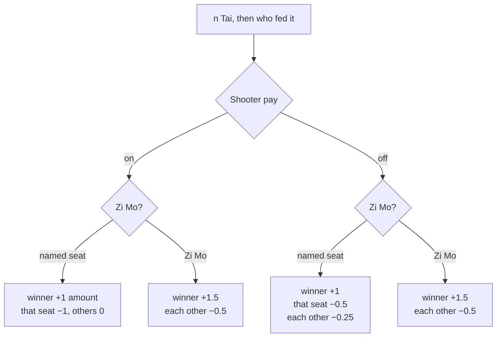

# Payouts

The money rules, implemented as pure functions in `score.py`. Figures assume the default `rate = 0.1`; scale by
`rate / 0.1` for any other rate. The exact numbers are pinned by `tests/golden_payouts.json`.

---

## Which wins ask "who fed it?"

Decided by `score.has_payer_stage(kind)`.

| Tapped | Asks who fed it | Why |
| --- | --- | --- |
| `n Tai`, `Kang` | yes | A discard caused it. |
| `Kang 暗`, `🐈`, `🐈 暗`, `🥀`, `🥀 暗` | no | Concealed, or an animal or flower, so nobody fed it. |

- `Zi Mo` (自摸) is a self-drawn win, so all three other seats pay.
- `暗` is concealed, so the payout is doubled.
- An empty seat is still a slot: it can win, feed, owe and be owed.

---

## Tai win

`amount = rate × TAI_LADDER[n]`. The ladder doubles per rung: `1→4, 2→8, 3→16, 4→32, 5→64 … 10→2048`, so
`$0.40` at 1 tai, `$1.60` at 3, `$6.40` at 5. A session offers rungs up to its Max Tai, never above
`score.MAX_TAI` (10).

---

## Kang, animal and flower

Flat multiples of `rate` alone; the tai ladder never applies.

| Entry | Shooter on | Shooter off |
| --- | --- | --- |
| `Kang` + named feeder | winner +0.30, feeder −0.30 | winner +0.30, the other three −0.10 each (the named feeder is ignored) |
| `Kang` + `Zi Mo` | winner +0.30, each −0.10 | winner +0.60, each −0.20 |
| `Kang 暗` | winner +0.60, each −0.20 | winner +1.20, each −0.40 |
| `🐈`, `🥀` | winner +0.30, each −0.10 | same |
| `🐈 暗`, `🥀 暗` | winner +0.60, each −0.20 | same |

---

## Settle-up

`score.settle` turns the non-zero balances into transfer lines. Empty seats take part and read
`Player 3 (empty) pays Al: $3.20`.

| Non-zero balances | Result |
| --- | --- |
| none | `No Payment` |
| one loser | They pay each winner their exact winnings. |
| one winner | Each loser pays the winner their exact loss. |
| two and two | See below. |

Two and two, comparing the biggest loss with the biggest win:

- **Loss is bigger:** the biggest loser pays the biggest winner in full and the remainder to winner 2. Loser 2
  then pays winner 2.
- **Win is bigger:** the biggest loser pays the biggest winner up to their loss. Loser 2 tops up winner 1, then
  pays winner 2.
